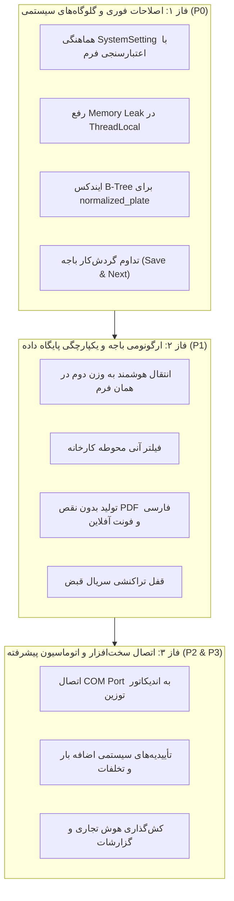
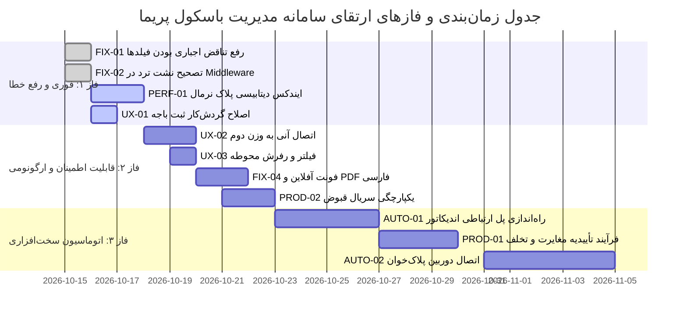

# نقشه راه جامع بهبود، ارتقا و توسعه محصول سامانه مدیریت باسکول «پریما باسکول»
## Prima Bascol - Product Improvement & Industrial Excellence Roadmap

---

## ۱. ارزیابی جامع معماری و ماژول‌های سامانه (Module-by-Module Audit)

این تحلیل بر مبنای بررسی مستقیم سورس‌کد، مدل‌های داده، ویوها، فرم‌ها، کنترل‌های فرانت‌اند و فرآیندهای کسب‌وکار انجام شده و تصویر دقیقی از وضعیت عملیاتی فعلی کارخانه و باجه باسکول ارائه می‌دهد:

### ۱.۱. ماژول ثبت توزین اول و دوم (Weighing Operations)
* **عملکرد فعلی:**
  توزین در دو حالت «ثبت وزن اول» (`ticket_create`) و سپس «ثبت وزن دوم» (`ticket_second_weight`) یا «تکمیل یک‌مرحله‌ای مستقیم» (Direct Complete) انجام می‌شود. محاسبات پر، خالی، خالص، افت و اختلاف بارنامه بلادرنگ در فرانت‌اند و در بک‌اند از طریق `TicketCalculationService` محاسبه می‌شوند.
* **میزان تکامل فرآیند:**
  حدود ۸۵٪ فرآیند عملیاتی پیاده شده است؛ اما گلوگاه‌های رفتاری مهمی در جریان کار باجه وجود دارد.
* **مشکلات و اصطکاک اپراتور باجه:**
  1. پس از ذخیره موفق وزن اول، سیستم اپراتور را به صفحه «کامیون‌های در محوطه» (`trucks_in_yard`) هدایت (Redirect) می‌کند؛ در حالی که در ساعات اوج ورود، صف خودروها پشت گیت است و اپراتور باید فوراً قبض بعدی را ثبت کند. این کار مستلزم یک کلیک اضافه و بارگذاری مجدد فرم است.
  2. در صورت رسیدن کامیون خروجی (وزن دوم) به باجه در حین باز بودن فرم ثبت توزین اول، اپراتور با وارد کردن پلاک پیام هشدار «این خودرو قبض باز دارد» را می‌بیند اما سیستم امکان پرش مستقیم یا بارگذاری وزن دوم در همان صفحه را فراهم نمی‌کند (نیاز به جابجایی صفحه دارد).
* **نقاط قوت:**
  محاسبه داینامیک خالص و ناخالص بر اساس `Math.max` و `Math.min` روی اوزان، کنترل اسکرول ماوس (جهت عدم تغییر سهوی ارقام)، و سازگاری با کلیدهای میانبر.

---

### ۱.۲. شناسایی خودرو و پلاک‌خوانی هوشمند (Plate Recognition & Vehicle Master)
* **عملکرد فعلی:**
  ویجت پلاک ۴ تکه ایران (`plate_part1`, `plate_letter`, `plate_part2`, `plate_iran`) همراه با نرمال‌سازی ارقام فارسی/انگلیسی و فراخوانی ایجکس `ajax_plate_lookup` جهت شناسایی پلاک، راننده پیش‌فرض، نوع خودرو، سوابق قبلی، و مسدودی در لیست سیاه.
* **مشکلات عملکردی و امنیتی:**
  1. در متد `VehicleDriverRegistrationService.resolve_or_create`، برای انطباق پلاک، کل رکوردهای جدول خودروها به حافظه RAM واکشی شده و در حلقه پایتون فیلتر می‌شوند (`for v in Vehicle.objects.all(): if normalize_plate(...)`). این امر با افزایش ترددها به چندهزار رکورد، باعث افت محسوس سرعت باجه و قفل منابع پایگاه داده خواهد شد.
  2. مدل `Vehicle` دارای ستون نمایشی `plate_display` ایندکس‌شده است اما ستون `normalized_plate` در مدل ذخیره نشده و مستقیماً ایندکس SQL ندارد.

---

### ۱.۳. صف خودروها و پایش محوطه کارخانه (Trucks in Yard & Yard Operations)
* **عملکرد فعلی:**
  نمایش لیست رکوردهای دارای وضعیت `WAITING_SECOND` یا `FIRST_REGISTERED` در قالب جدولی تمیز به همراه محاسبه مدت زمان توقف در محوطه و برچسب هشدار توقف بیش از ۳ ساعت.
* **کاستی‌های عملیاتی:**
  1. عدم وجود باکس فیلتر آنی (Real-time Instant Search) بر اساس پلاک یا نام راننده در جدول محوطه. اپراتور در صورت وجود ۵۰ خودرو در محوطه باید به صورت چشمی یا از طریق جستجوی مرورگر پلاک را پیدا کند.
  2. عدم به‌روزرسانی خودکار جدول (Auto Refresh / Polling). اپراتور متوجه ورود یا خروج تغییرات جدید بدون Refresh صفحه نمی‌شود.

---

### ۱.۴. محاسبه افت، تناژ و مغایرت با بارنامه (Loss & Tolerance Calculations)
* **عملکرد فعلی:**
  تعیین افت بر اساس درصد پیش‌فرض کالا یا وارد کردن مقدار دستی با تیک `is_loss_overridden` و علت تغییر؛ بررسی تلورانس مغایرت باسکول با بارنامه بر اساس حد مجاز کالا (`standard_tolerance_kg`).
* **کاستی‌ها و خطاهای رفتاری:**
  در صورت اضافه بار مجاز یا غیرمجاز، سیستم تنها یک نشانگر زرد یا قرمز در فرانت‌اند نشان می‌دهد؛ اما اعتبارسنجی قطعی سیستمی برای الزام به ورود مجوز تناژ مازاد (Overload Authorization) یا ثبت تأییدیه سرپرست شیفت در زمان ثبت نهایی تعبیه نشده است.

---

### ۱.۵. دریافت خودکار وزن از اندیکاتور باسکول (Hardware Weighing Indicator)
* **عملکرد فعلی:**
  کلاس انتزاعی `BaseWeightProvider` و کلاس `ManualWeightProvider` پیاده‌سازی شده و بج "باسکول آنلاین: آماده دریافت" به صورت نمادین در فرم وجود دارد؛ اما در واقعیت هیچ درایور سخت‌افزاری فعال، سرویس وب‌سوکت، یا ایجنت اتصال به پورت سریال (RS-232 / RS-485 / TCP-IP) وجود ندارد و اپراتور اعداد را از مانیتور باسکول به شکل دستی تایپ می‌کند.
* **خطر سازمانی:**
  خطای انسانی ناشی از جابجایی ارقام، تایپ سهوی صفر اضافه، یا دستکاری عمدی بدون لاگ سخت‌افزاری پایدار.

---

### ۱.۶. مرکز چاپ و صدور قبوض (Ticket Printing Engine)
* **عملکرد فعلی:**
  پشتیبانی از قالب‌های چاپ A4، A5 و فیش حرارتی ۸۰ میلی‌متری POS (`ticket_print_pos.html`) به همراه چاپ تجمیعی و امکان چاپ بارکد دو‌بعدی QR.
* **نقص بحرانی در محیط ایزوله صنعتی (Offline Factory):**
  در قالب فیش حرارتی، فونت وزیرمتن مستقیماً از شبکه توزیع محتوای خارجی (`https://cdn.jsdelivr.net/...`) فراخوانی می‌شود. در باجه‌های کارخانجات که به دلایل حفاظتی و امنیتی به اینترنت متصل نبوده و تنها به شبکه داخلی (Intranet) دسترسی دارند، این فراخوانی با تاخیر بالا یا شکست مواجه شده و چیدمان پرینتر حرارتی به هم می‌ریزد.

---

### ۱.۷. گزارش‌گیری، خروجی‌ها و هوش تجاری (Reporting & Exports)
* **عملکرد فعلی:**
  گزارش‌های جامع مالی و عملیاتی، تحلیل ۶ بعدی طرف‌های حساب (`PartyAnalyticsService`)، گزارش عملکرد اپراتورها و خروجی اکسل/CSV.
* **نقص فنی:**
  متد خروجی PDF در `reports/exports.py` از فونت لاتین `Helvetica` در ReportLab استفاده کرده و فاقد موتور چیدمان متن فارسی (Bidi & Reshaping) و بارگذاری فونت محلی فارسی است که منجر به به هم ریختگی متون فارسی در PDF تولیدی می‌گردد.

---

## ۲. اولویت‌بندی جامع نیازمندی‌ها و اقدامات اصلاحی

| کد | عنوان اقدام | دسته | سطح دشواری | اولویت |
| :---: | :--- | :---: | :---: | :---: |
| **FIX-01** | هماهنگ‌سازی فیلدهای اجباری فرم با تنظیمات کارخانه (`SystemSetting`) | A. اصلاحات اساسی | بسیار پایین (Low) | **P0** |
| **FIX-02** | اصلاح نشت اطلاعات ترد محلی در میدل‌ور لاگ (`ThreadLocalRequestMiddleware`) | A. اصلاحات اساسی | بسیار پایین (Low) | **P0** |
| **FIX-03** | ایندکس‌گذاری مستقیم پلاک نرمال در پایگاه داده جهت رفع گلوگاه RAM | C. بهینه‌سازی کارایی | پایین (Low) | **P0** |
| **UX-01** | اصلاح جریان هدایت اپراتور پس از ثبت وزن اول (توالی بی‌وقفه باجه) | B. بهبود فرآیند و ارگونومی | بسیار پایین (Low) | **P0** |
| **UX-02** | موتور انتقال آنی از فرم ورود به وزن دوم در صورت مشاهده پلاک در محوطه | B. بهبود فرآیند و ارگونومی | متوسط (Medium) | **P1** |
| **UX-03** | فیلتر آنی و کلیدهای دسترسی سریع در لیست کامیون‌های داخل محوطه | B. بهبود فرآیند و ارگونومی | پایین (Low) | **P1** |
| **FIX-04** | رفع خطای فونت فارسی در خروجی PDF و ایزوله‌سازی فونت فیش پرینتر (آفلاین) | A. اصلاحات اساسی | پایین (Low) | **P1** |
| **SEC-01** | قفل خوش‌بینانه و اعتبارسنجی یکتایی سریال قبض در شبکه همزمان | A. اصلاحات اساسی | پایین (Low) | **P1** |
| **AUTO-01** | ایجنت نرم‌افزاری اتصال پورت سریال اندیکاتور (خواندن مستقیم و بدون خطا) | E. اتوماسیون صنعتی | متوسط (Medium) | **P1** |
| **PROD-01** | مکانیسم اخذ مجوز سرپرست در صورت تخطی از تلورانس یا تغییر وزن | D. ارتقای محصول | متوسط (Medium) | **P2** |
| **PROD-02** | کش‌گذاری زمان‌بندی‌شده و پیش‌محاسبه تحلیل‌های ۶ بعدی طرف‌های حساب | C. بهینه‌سازی کارایی | متوسط (Medium) | **P2** |
| **AUTO-02** | ثبت عکس دوربین پلاک‌خوان و متادیتا هنگام پایدار شدن وزن روی باسکول | E. اتوماسیون صنعتی | بالا (High) | **P3** |

---

## ۳. جزییات فنی و شناسنامه اصلاحات (Detailed Improvement Specifications)



---

### دسته A: اصلاحات اساسی و خطاهای بالقوه (Essential Fixes)

#### شناسه: FIX-01
* **عنوان:** رفع تناقض میان تنظیمات سیستم (`SystemSetting`) و اعتبارسنجی اجباری فرم ثبت قبض
* **رفتار فعلی:**
  در مدل `SystemSetting` فیلدهای `require_origin`، `require_destination` و `require_unload_location` تعریف شده‌اند (با مقدار پیش‌فرض `False`) تا مدیر کارخانه تعیین کند آیا مبدأ، مقصد و جایگاه تخلیه اجباری هستند یا خیر. اما در `weighbridge/forms.py` (سطرهای ۱۲۱ الی ۱۲۶) و اعتبارسنجی جاوااسکریپت `ticket_create.html` (سطرهای ۵۱۴ الی ۵۳۱)، این سه فیلد به صورت سخت‌افزاری و قطعی اجباری (`required = True`) شده‌اند.
* **مشکل شناسایی‌شده:**
  اپراتور در صنایعی که مبدأ یا مقصد بار ثابت است یا نیاز به ثبت جایگاه ندارد، مجبور است مقادیر تکراری یا ساختگی وارد کند که سبب کاهش سرعت و بی‌اثر شدن تنظیمات مدیریتی نرم‌افزار شده است.
* **راهکار پیشنهادی:**
  در متد `TicketCreateForm.__init__`، وضعیت `required` فیلدهای یادشده بر مبنای مقادیر شیء تنظیمات فعال سیستم (`SystemSetting.get_settings()`) مقداردهی پویا شود و متغیرهای کنترلی متناظر به فرانت‌اند ارسال شوند تا تابع جاوااسکریپت `getMissingMandatoryFields()` نیز شرط اجباری بودن را طبق همان تنظیمات بسنجد.
* **مزایای عملیاتی:** انعطاف‌پذیری کامل نرم‌افزار در کارخانجات مختلف بدون نیاز به کدنویسی اختصاصی؛ حذف حداقل ۳ ورودی اجباری بی‌مورد برای اپراتور.
* **سطح دشواری:** پایین (Low) | **اولویت:** **P0**
* **فایل‌های تحت تأثیر:**
  - `weighbridge/forms.py`
  - `templates/weighbridge/ticket_create.html`
* **معیارهای پذیرش (Acceptance Criteria):**
  - در صورتی که در پنل مدیریت، تیک «الزام مبدأ و مقصد» برداشته شود، فرم بدون خطا و بدون نیاز به انتخاب آنها ثبت شود.
  - کادرهای قرمز اعتبارسنجی فرانت‌اند تنها برای فیلدهایی که در تنظیمات فعال هستند ظاهر شوند.
* **ریسک‌های رگرسیون و آزمون‌ها:**
  - ریسک خالی ماندن داده در صورت بی‌دقتی مدیر سیستم؛ آزمون: ثبت قبض با تنظیمات روشن و خاموش و سنجش ذخیره دیتابیس.

---

#### شناسه: FIX-02
* **عنوان:** محافظت از نشتی داده کاربران در میدل‌ور لاگ از طریق بلاک `try ... finally`
* **رفتار فعلی:**
  در `core/middleware.py` متد `__call__` کلاس `ThreadLocalRequestMiddleware` پس از فراخوانی `response = self.get_response(request)` ارجاعات `_thread_locals.user` و `ip_address` را پاک می‌کند.
* **مشکل شناسایی‌شده:**
  در صورتی که در طول پردازش درخواست یک استثنا (Unhandled Exception) رخ دهد، کدهای پاک‌سازی اجرا نمی‌شوند. در سرورهای تولیدی مبتنی بر ترد (مانند Gunicorn gthread یا Waitress)، ترد بازیافت شده و درخواست بعدی کاربر دیگر ممکن است تا پیش از رونویسی، هویت کاربر خطاخورده قبلی را در Audit Log ثبت کند.
* **راهکار پیشنهادی:**
  قراردادن پاک‌سازی ترد محلی در بلاک `finally`:
  ```python
  try:
      response = self.get_response(request)
      return response
  finally:
      _thread_locals.user = None
      _thread_locals.ip_address = None
  ```
* **مزایای عملیاتی:** تضمین صددرصدی صحت و اعتبار حقوقی لاگ‌های سیستم (Audit Logs).
* **سطح دشواری:** بسیار پایین (Low) | **اولویت:** **P0**
* **فایل‌های تحت تأثیر:**
  - `core/middleware.py`
* **معیارهای پذیرش:** پاک شدن تضمینی ترد محلی در زمان بروز خطای ۵۰۰ یا قطعی ارتباط کاربر.

---

#### شناسه: FIX-04
* **عنوان:** اصلاح فونت و چیدمان فارسی در گزارش PDF و ایزوله‌سازی فونت فیش پرینتر برای محیط‌های آفلاین
* **رفتار فعلی:**
  1. در `reports/exports.py` متد `export_pdf` از استایل پیش‌فرض با `Helvetica` استفاده می‌کند که کاراکترهای فارسی را پشتیبانی نکرده و باعث خروجی مخدوش یا کرش گزارش‌گیری می‌شود.
  2. در `templates/weighbridge/ticket_print_pos.html` سطر ۸، فایل استایل فونت وزیرمتن مستقیماً از وب‌سایت `cdn.jsdelivr.net` لود می‌شود.
* **مشکل شناسایی‌شده:**
  در کارخانجاتی که شبکه محلی باجه ایزوله از اینترنت است، فیش پرینتر با تاخیر یا با فونت ناخوانا چاپ می‌کند و دانلود PDF گزارشات با خطا مواجه می‌شود.
* **راهکار پیشنهادی:**
  1. قرار دادن بسته‌های وب‌فونت و فایل‌های TTF وزیرمتن (`Vazirmatn.ttf`) در پوشه محلی `static/fonts/`.
  2. در `ticket_print_pos.html` فونت به صورت محلی لود شود: ``.
  3. در `reports/exports.py`، ثبت فونت با `pdfmetrics.registerFont` به همراه اتصال کتابخانه‌های چیدمان راست‌به‌چپ (`arabic_reshaper` و `bidi.algorithm`).
* **مزایای عملیاتی:** عملکرد مستقل و قطعی در باجه‌های کاملاً آفلاین؛ چاپ فوق‌العاده سریع و استاندارد فیش‌های حرارتی.
* **سطح دشواری:** پایین (Low) | **اولویت:** **P1**
* **فایل‌های تحت تأثیر:**
  - `templates/weighbridge/ticket_print_pos.html`
  - `templates/weighbridge/ticket_print_a4.html`
  - `templates/weighbridge/ticket_print_a5.html`
  - `reports/exports.py`
* **معیارهای پذیرش:** چاپ موفق فیش در سیستمی که دسترسی به اینترنت آن قطع شده است بدون هیچ تغییری در ابعاد و ظاهر فیش.

---

### دسته B: بهبود فرآیندها و ارگونومی باجه (Workflow & Usability Improvements)

#### شناسه: UX-01
* **عنوان:** اصلاح گردش‌کار اپراتور پس از ثبت وزن اول و حذف پرش ناخواسته به صفحه محوطه
* **رفتار فعلی:**
  در ویوی `ticket_create` (سطر ۱۵۲ فایل `weighbridge/views.py`) پس از ذخیره موفق قبض در حالت وزن اول، سیستم دستور زیر را صادر می‌کند:
  `return redirect("weighbridge:trucks_in_yard")`
* **مشکل شناسایی‌شده:**
  در شیفت‌های پرترافیک صبح و بعدازظهر، چندین کامیون در صف ورود باسکول هستند. هدایت به صفحه محوطه موجب می‌شود اپراتور مجبور شود دکمه «ثبت قبض جدید» را مجدداً کلیک کرده و منتظر لود صفحه بماند. این فرآیند روزانه صدها ثانیه اتلاف وقت ایجاد می‌کند.
* **راهکار پیشنهادی:**
  تعبیه دکمه‌های کنترلی چندگانه در انتهای فرم ثبت توزین اول:
  1. «ثبت و بارگذاری فرم جدید» (کلید میانبر: `F8` یا `Ctrl+Enter`) که فرم خالی جدید را با تمرکز (Focus) مستقیم روی ورودی پلاک باز کند.
  2. «ثبت و چاپ برگه ورود» (در صورت لزوم تحویل برگه نوبت به راننده).
  3. امکان انتخاب رفتار پیش‌فرض پس از ذخیره در تنظیمات کاربری یا تنظیمات سیستم.
* **مزایای عملیاتی:** تسریع عملیات پذیرش خودروها به میزان حداقل ۵ تا ۸ ثانیه در هر توزین؛ تمرکز مداوم اپراتور روی صف ورودی.
* **سطح دشواری:** بسیار پایین (Low) | **اولویت:** **P0**
* **فایل‌های تحت تأثیر:**
  - `weighbridge/views.py`
  - `templates/weighbridge/ticket_create.html`
* **معیارهای پذیرش:** اپراتور بلافاصله پس از ثبت وزن اول، بدون نیاز به تعویض صفحه، آماده تایپ پلاک خودروی بعدی باشد.

---

#### شناسه: UX-02
* **عنوان:** انتقال هوشمند و یک‌کلیکه به توزین دوم هنگام ورود پلاک خودروی داخل محوطه
* **رفتار فعلی:**
  اگر خودرویی که قبلاً وزن اول آن ثبت شده و اکنون در محوطه در حال بارگیری بوده است، روی کفه باسکول خروجی قرار گیرد و اپراتور که صفحه `ticket_create` جلویش باز است پلاک آن را تایپ کند، ایجکس هشدار زرد رنگ نمایش می‌دهد: «این خودرو یک قبض باز دارد»، اما فرم در همان حالت می‌ماند.
* **مشکل شناسایی‌شده:**
  اپراتور باید روی لینک داخل هشدار کلیک کند تا صفحه به `ticket_second_weight/<id>/` ریدایرکت شود، که باعث از دست رفتن تمرکز کیبورد و اتلاف زمان می‌شود.
* **راهکار پیشنهادی:**
  1. در همان صفحه `ticket_create`، به محض تشخیص پلاک دارای قبض باز، یک دیالوگ سبک با میانبر `Enter` ظاهر شود: «انتقال فوری به ثبت وزن دوم».
  2. به‌صورت آلترناتیو، فرم به صورت هوشمند وزن وارد شده را به عنوان وزن دوم همان قبض باز تلقی کرده و اطلاعات وزن اول را در سایدبار بارگذاری کند تا اپراتور بدون تغییر URL بتواند با زدن کلید ثبت نهایی، قبض را تسویه و پرینت کند.
* **مزایای عملیاتی:** حذف سردرگمی اپراتورهای تازه‌کار؛ جلوگیری از ثبت تصادفی قبض دوم با وزن صفر یا ابطال‌های اشتباه.
* **سطح دشواری:** متوسط (Medium) | **اولویت:** **P1**
* **فایل‌های تحت تأثیر:**
  - `static/js/industrial-app.js`
  - `templates/weighbridge/ticket_create.html`
  - `weighbridge/views.py`

---

#### شناسه: UX-03
* **عنوان:** افزودن فیلتر جستجوی آنی (Instant Search) و رفرش بدون وقفه در صفحه کامیون‌های در محوطه
* **رفتار فعلی:**
  صفحه `trucks_in_yard.html` صرفاً جدول رکوردهای در انتظار را با پیمایش صفحه نشان می‌دهد و فاقد اینپوت جستجو است.
* **مشکل شناسایی‌شده:**
  در کارخانجاتی با محوطه‌های بزرگ (مانند کارخانه‌های فولاد یا سیمان) که در هر لحظه ۳۰ تا ۷۰ کامیون در محوطه حضور دارند، یافتن رکورد مربوط به کامیونی که راننده‌اش به باجه مراجعه کرده مستلزم اسکرول دستی است.
* **راهکار پیشنهادی:**
  1. افزودن فیلد جستجوی سریع در بالای جدول (فیلتر بر اساس شماره پلاک، نام راننده یا شماره بارنامه) بدون نیاز به ارسال درخواست به سرور (Client-side DOM filter).
  2. پیاده‌سازی تایمر به‌روزرسانی نامحسوس (هر ۲۰ ثانیه یک‌بار با استفاده از Fetch API) تا در صورت خروج یا ورود خودروها، شمارنده محوطه همواره دقیق بماند.
* **مزایای عملیاتی:** دسترسی زیر ۱ ثانیه به مشخصات هر کامیون در صف خروج.
* **سطح دشواری:** پایین (Low) | **اولویت:** **P1**
* **فایل‌های تحت تأثیر:**
  - `templates/weighbridge/trucks_in_yard.html`
  - `static/js/industrial-app.js`

---

### دسته C: بهینه‌سازی کارایی و پاسخ‌دهی (Performance Improvements)

#### شناسه: PERF-01
* **عنوان:** اضافه کردن فیلد ایندکس‌شده `normalized_plate` به جدول `Vehicle` و حذف حلقه جستجو در RAM
* **رفتار فعلی:**
  در متد `VehicleDriverRegistrationService.resolve_or_create` (سطرهای ۱۶۸ تا ۱۷۲ فایل `weighbridge/services.py`)، برای یافتن خودرو بر اساس پلاک وارد شده، در صورت عدم تطابق با رشته دقیق، دستور زیر اجرا می‌شود:
  ```python
  for v in Vehicle.objects.select_related("vehicle_type", "default_driver").all():
      if normalize_plate(v.plate_display) == norm_p:
          vehicle = v
          break
  ```
  عین همین حلقه در ویوی `ajax_plate_lookup` نیز وجود دارد!
* **مشکل شناسایی‌شده:**
  این دستور در هر بار ثبت قبض و در هر بار تایپ پلاک توسط اپراتور، کل پایگاه داده خودروها را در حافظه سرور واکشی کرده و تک‌تک با تابع پایتون مقایسه می‌کند. در سیستمی با ۱۰,۰۰۰ پلاک، این عملیات مرتبه زمانی $O(N)$ داشته و باعث کندی شدید و مصرف سنگین CPU سرور خواهد شد.
* **راهکار پیشنهادی:**
  1. افزودن فیلد `normalized_plate = models.CharField(max_length=50, db_index=True, blank=True)` به مدل `Vehicle`.
  2. مقداردهی خودکار این فیلد در متد `save()` مدل خودرو.
  3. جایگزینی حلقه بالا با یک کوئری ساده و ایندکس‌شده پایگاه داده با مرتبه $O(1)$:
     ```python
     vehicle = Vehicle.objects.filter(normalized_plate=norm_p).first()
     ```
* **مزایای عملیاتی:** پاسخ‌دهی ایجکس پلاک‌خوانی در کمتر از ۱۰ میلی‌ثانیه؛ حذف کامل سربار پردازشی سرور.
* **سطح دشواری:** پایین (Low) | **اولویت:** **P0**
* **فایل‌های تحت تأثیر:**
  - `masterdata/models.py`
  - `weighbridge/services.py`
  - `weighbridge/views.py`
* **معیارهای پذیرش:** اجرای موفقیت‌آمیز مایگریشن و کاهش زمان پاسخگویی `ajax_plate_lookup` به زیر ۱۵ میلی‌ثانیه برای ۱۰ هزار رکورد.

---

#### شناسه: PERF-02
* **عنوان:** کش‌گذاری محاسبات سنگین در تحلیل‌های ۶ بعدی طرف‌های حساب (`PartyAnalyticsService`)
* **رفتار فعلی:**
  ماژول `PartyAnalyticsService` محاسبات فوق‌العاده جامعی در ابعاد مالی، فراوانی، فصلی، روند تناژ و سودآوری طرف‌های حساب انجام می‌دهد. اما اجرای زنده آن روی کل قبوض باسکول در بازه‌های زمانی طولانی بدون کش انجام می‌شود.
* **راهکار پیشنهادی:**
  استفاده از کش داخلی جنگو (`django.core.cache`) با کلیدهای ترکیبی بر اساس بازه تاریخ و شناسه طرف حساب و انقضای ۶۰ دقیقه‌ای یا نامعتبرسازی هوشمند (Cache Invalidation) در زمان ثبت قبض قطعی جدید.
* **سطح دشواری:** متوسط (Medium) | **اولویت:** **P2**
* **فایل‌های تحت تأثیر:**
  - `parties/services.py` یا `reports/views.py`

---

### دسته D: ارتقای محصول و جلوگیری از تخلفات (Professional Product Enhancements)

#### شناسه: PROD-01
* **عنوان:** ماژول مدیریت اضافه بار و مجوزهای تخطی از تلورانس استاندارد
* **رفتار فعلی:**
  در صورت مغایرت وزن ناخالص با بارنامه بیش از حد مجاز کالا (`standard_tolerance_kg`)، سیستم فیلد `is_tolerance_exceeded = True` را ذخیره می‌کند و پیام زرد به کاربر می‌دهد، اما هیچ مانعی برای صدور و پرینت قبض وجود ندارد.
* **مشکل شناسایی‌شده:**
  در صنایع فولاد و مواد معدنی، کسری بار یا اضافه بار بیش از ۵۰ یا ۱۰۰ کیلوگرم می‌تواند نشانه تبانی، سرقت یا خطای جدی لودرچی باشد. ثبت بدون نظارت قبض مغایرت‌دار ریسک زیان مالی دارد.
* **راهکار پیشنهادی:**
  1. اگر `is_tolerance_exceeded == True` شد، وضعیت قبض به `PENDING_APPROVAL` تغییر کند.
  2. امکان چاپ برگه نهایی تا زمان درج کد تأیید سرپرست باسکول یا ثبت علت مغایرت مسدود گردد.
  3. لاگ ویژه‌ای برای هشدارهای تلورانس در داشبورد مدیریت نمایش داده شود.
* **مزایای عملیاتی:** پیشگیری قطعی از تبانی و اتلاف سرمایه مواد ورودی/خروجی؛ ارتقای سطح کنترل داخلی کارخانه.
* **سطح دشواری:** متوسط (Medium) | **اولویت:** **P1**
* **فایل‌های تحت تأثیر:**
  - `weighbridge/models.py`
  - `weighbridge/views.py`
  - `weighbridge/forms.py`

---

#### شناسه: PROD-02
* **عنوان:** قفل خوش‌بینانه و اعتبارسنجی سریال قبض در ترافیک بالای باجه‌های موازی
* **رفتار فعلی:**
  در `SerialNumberService` بالاترین شماره سریال با خواندن ۱۰۰ رکورد آخر بررسی می‌شود (`tickets.order_by("-id")[:100]`).
* **مشکل شناسایی‌شده:**
  اگر کارخانه دارای ۲ باجه ورودی و خروجی همزمان باشد یا رکوردهایی از سیستم قبلی ایمپورت شده باشد، سقف ۱۰۰ رکورد آخر می‌تواند منجر به تداخل و خطای یکتایی دیتابیس (`IntegrityError`) روی فیلد `serial_number` گردد.
* **راهکار پیشنهادی:**
  تخصیص یک جدول اختصاصی شمارنده متوالی (`SequenceCounter`) با ردیف اختصاصی برای هر پیشوند یا سال مالی همراه با `select_for_update()` جهت تولید بدون خطای شماره سریال ترتیبی بدون وابستگی به پیمایش رکوردهای قبوض.
* **سطح دشواری:** پایین (Low) | **اولویت:** **P1**
* **فایل‌های تحت تأثیر:**
  - `weighbridge/services.py`
  - `core/models.py`

---

### دسته E: اتوماسیون پیشرفته و اتصال تجهیزات (Advanced Industrial Automation)

#### شناسه: AUTO-01
* **عنوان:** پیاده‌سازی سرویس ایجنت خواندن مستقیم وزن از اندیکاتور باسکول (Serial/TCP Bridge)
* **رفتار فعلی:**
  ورود وزن تماماً متکی بر چشم و دست اپراتور است (`ManualWeightProvider`).
* **مشکل شناسایی‌شده:**
  خطای انسانی، زمان‌بر بودن تایپ ۵ یا ۶ رقم وزن، و امکان ثبت اعداد نادرست یا غیرواقعی بدون حضور خودرو روی کفه باسکول.
* **راهکار پیشنهادی:**
  پیاده‌سازی ماژول سبک کلاینت صنعتی (Local Hardware Bridge) به یکی از دو روش:
  1. **روش وب‌سوکت محلی (Local WebSocket Bridge):** یک سرویس پایتونی سبک/Go روی ویندوز باجه که پورت سریال (مانند `COM1` / `COM3`) را با پروتکل متداول اندیکاتورهای رایج بازار ایران (مانند توزین الکتریک، گاما، صاایران، یاهوآ Yaohua XK3190) مانیتور کرده و با دریافت رشته پایدار (Stable Weight)، مقدار را از طریق وب‌سوکت به فرم وب پاس می‌دهد.
  2. کلید «دریافت وزن از باسکول» روی فرم، در صورت فشردن، مستقیماً آخرین وزن پایدار کفه را بدون قابلیت تغییر دستی درج می‌کند.
* **مزایای عملیاتی:** صفر شدن خطای انسانی در ثبت وزن؛ سرعت ثبت فوق‌العاده در باجه؛ تطابق با استانداردهای کارخانجات تراز اول صنعتی.
* **سطح دشواری:** متوسط (Medium) | **اولویت:** **P1**
* **فایل‌های تحت تأثیر:**
  - `core/weight_provider.py`
  - `static/js/industrial-app.js`
  - افزودن اسکریپت سرویس کلاینت `hardware_bridge/`

---

#### شناسه: AUTO-02
* **عنوان:** اتصال دوربین پلاک‌خوان (ANPR) و عکاسی خودکار هنگام ثبت وزن
* **رفتار فعلی:**
  سامانه فاقد ثبت تصویر کفه و پلاک است.
* **راهکار پیشنهادی:**
  قابلیت دریافت snapshot از دوربین تحت شبکه (RTSP/ONVIF) مستقر در ورودی و خروجی کفه باسکول در لحظه ثبت وزن اول و دوم و پیوست خودکار تصاویر به قبض توزین جهت استناد در گزارشات بازرسی و حراست.
* **مزایای عملیاتی:** مسدودسازی قطعی هرگونه جابجایی بارنامه یا ثبت قبض برای خودرویی که روی باسکول حاضر نبوده است.
* **سطح دشواری:** بالا (High) | **اولویت:** **P3**
* **فایل‌های تحت تأثیر:**
  - `weighbridge/models.py`
  - `weighbridge/views.py`

---

## ۴. برنامه فازبندی اجرا (Execution Roadmap Timeline)



### خلاصه‌سازی مراحل:
1. **اسپرینت ۱ (اقدامات بحرانی - زیر ۴۸ ساعت):**
   - پیاده‌سازی `FIX-01` (انعطاف فیلدها طبق تنظیمات)، `FIX-02` (ایمنی لاگ)، `PERF-01` (ایندکس پلاک) و `UX-01` (ثبت پیوسته در باجه).
2. **اسپرینت ۲ (بهبود ارگونومی و عملیات باجه - ۵ روز کاری):**
   - پیاده‌سازی `UX-02` و `UX-03` (تسریع کار با خودروهای در محوطه)، `FIX-04` (چاپ و PDF کاملاً آفلاین)، `PROD-02` (تضمین سریال بدون تصادم).
3. **اسپرینت ۳ (مزیت رقابتی و اتوماسیون کارخانه‌ای - ۱۰ روز کاری):**
   - راه‌اندازی ارتباط مستقیم پورت سریال اندیکاتور باسکول (`AUTO-01`) و کنترل سیستمی تخلفات تلورانس (`PROD-01`).

---

## ۵. ماتریس تحلیل ریسک و آزمون‌های رگرسیون (Risk & QA Matrix)

| کد تغییر | ریسک بالقوه رگرسیون | راهکار پیشگیری و آزمون کنترل کیفیت (QA Test) |
| :---: | :--- | :--- |
| **FIX-01** | ارسال مقادیر Null به فیلدهای الزامی در صورت تفاوت منطق فرانت و بک | تست یکپارچگی ثبت قبض با هر ۸ حالت خاموش/روشن بودن ۳ فیلد تنظیمات. |
| **PERF-01** | عدم مقداردهی پلاک نرمال برای رکوردهای قدیمی موجود در پایگاه داده | اجرای یک اسکریپت Data Migration برای محاسبه و پرکردن `normalized_plate` برای خودروهای پیشین. |
| **UX-01** | سردرگمی اپراتور ناشی از تغییر رفتار پیش‌فرض کلید اینتر | نگه‌داشتن گزینه‌های واضح با کلیدهای میانبر استاندارد F-keys و برچسب‌های راهنما. |
| **FIX-04** | ناسازگاری اندازه فونت‌ها در درایورهای قدیمی پرینترهای حرارتی | تست خروجی پرینت با چاپگرهای رایج Bixolon, Epson و زینک‌های مختلف ۸۰ و ۵۸ میلی‌متری. |
| **AUTO-01** | قطع شدن کابل سریال در حین توزین و معطل ماندن اپراتور | طراحی کلید Fallback فوری «توزین دستی» برای مواردی که سخت‌افزار اندیکاتور خاموش یا قطع است. |

---
**تهیه شده توسط:** تیم معماری نرم‌افزارهای صنعتی و مشاور ارتقای محصول
**پروژه:** سامانه مدیریت و توزین باسکول کارخانه‌ای «پریما باسکول»
